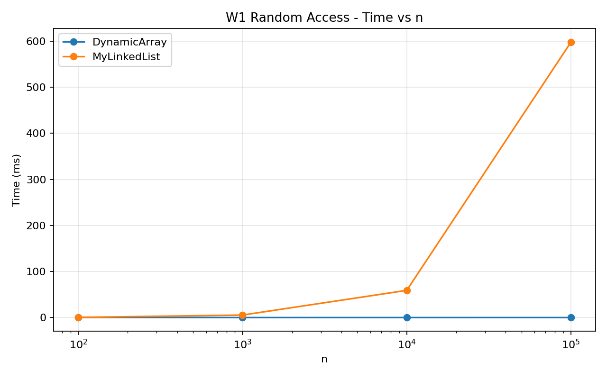
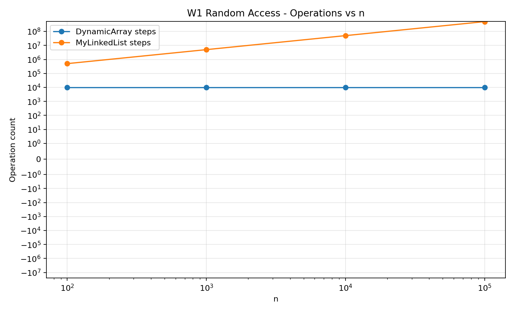
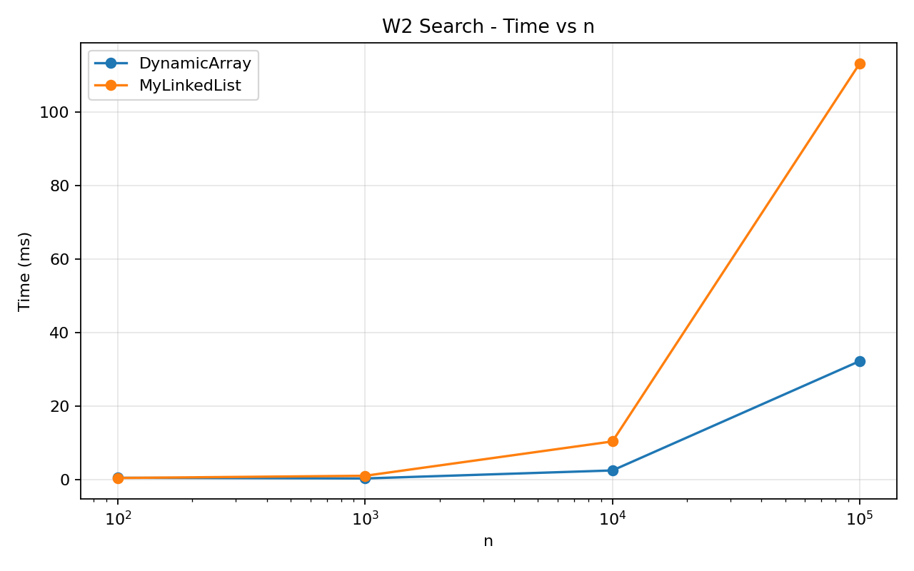
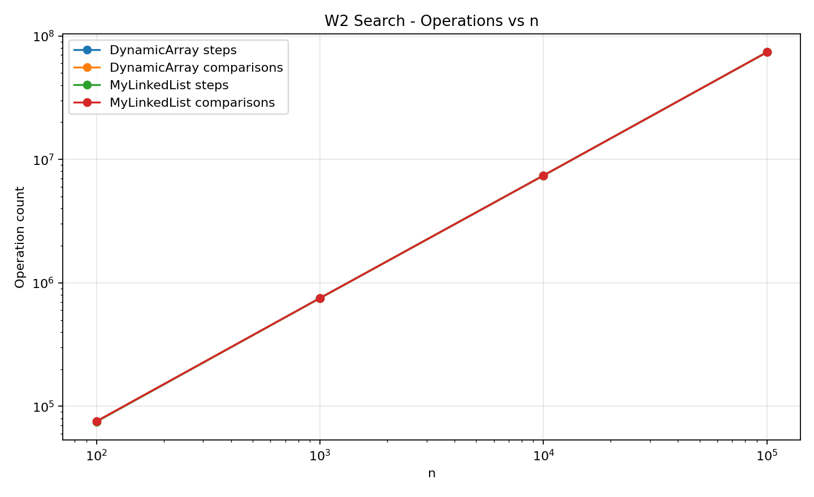
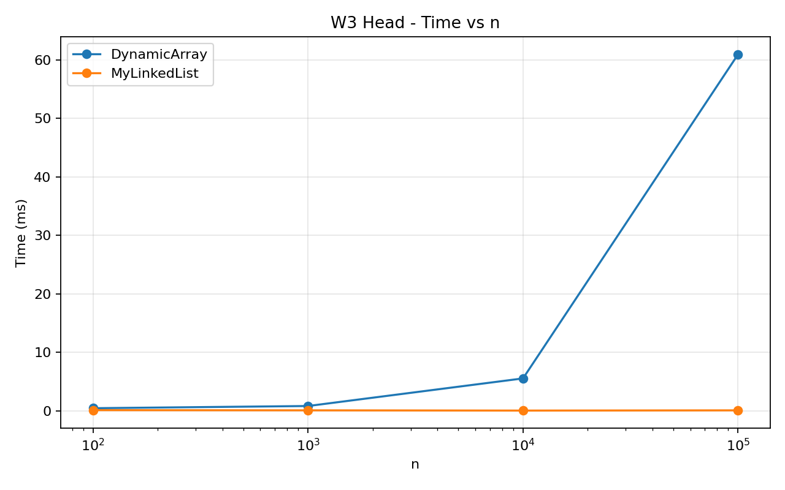
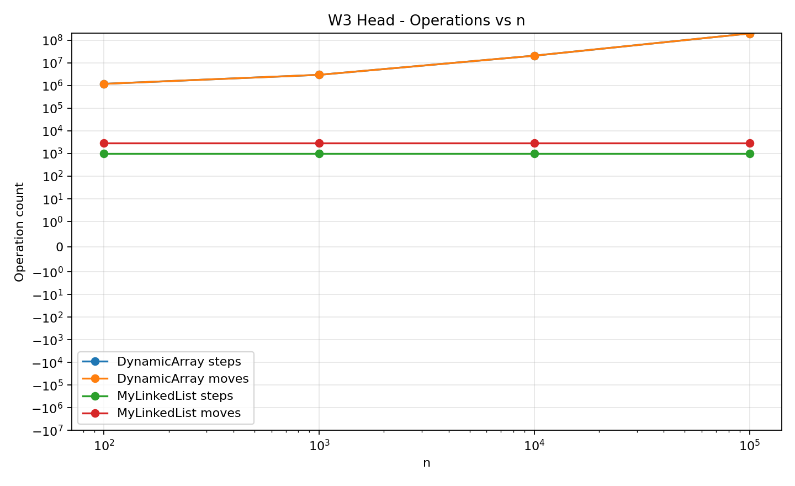
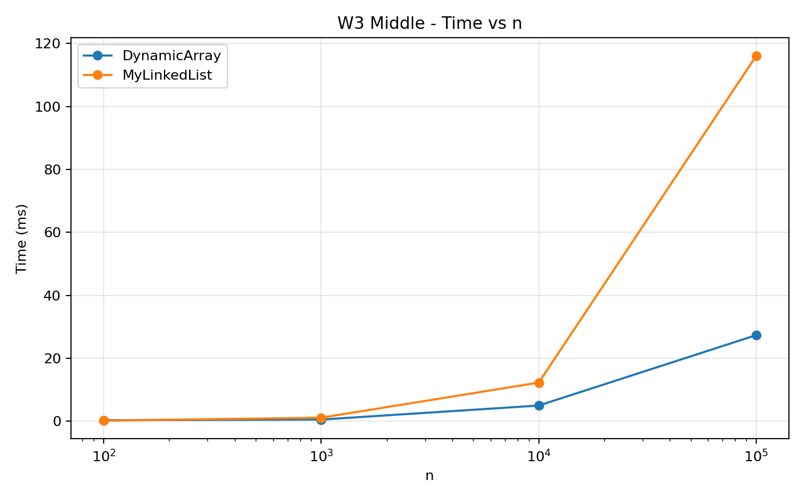
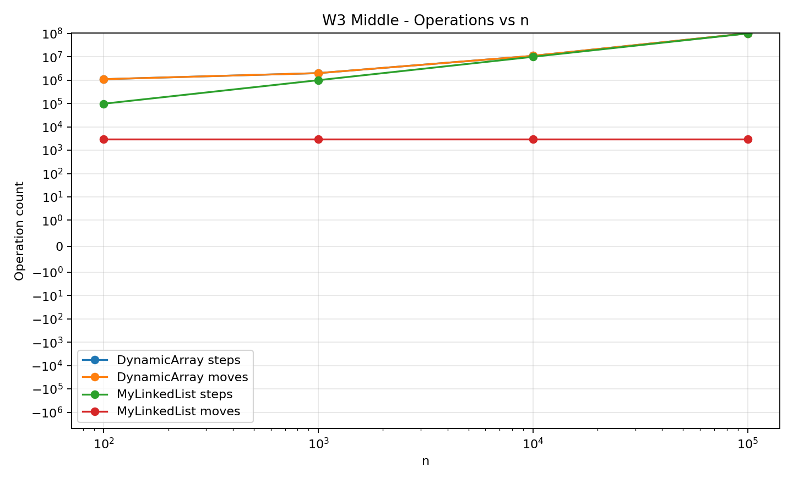
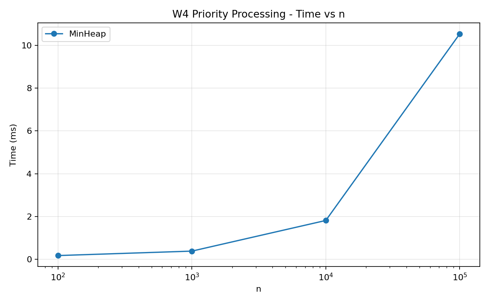
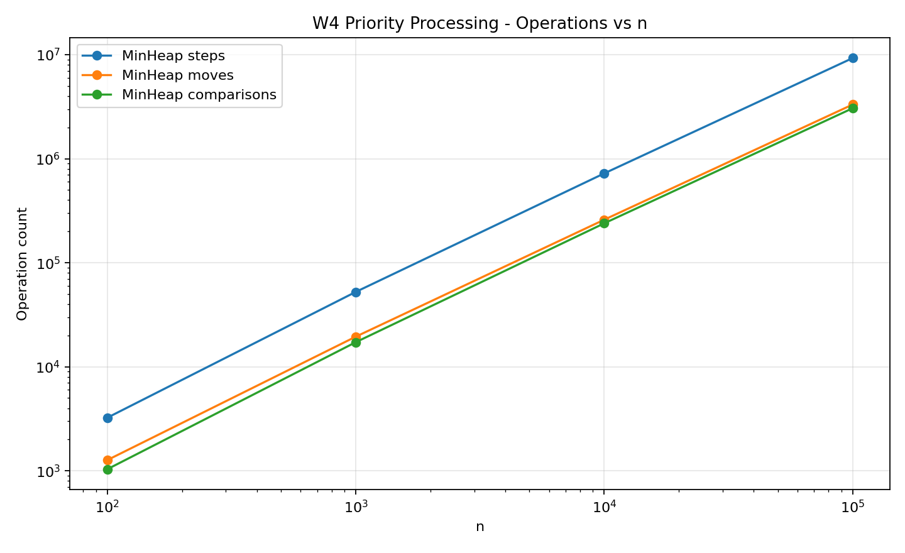

# Assignment 2 - Data Structures Report

**Student:** Islam Tauyekel  
**Group:** change to your group before submission

## 1. Short description

The goal of this assignment was to compare three data structures that were implemented from scratch. I implemented `DynamicArray`, `MyLinkedList`, and `MinHeap`. The list-like structures use the same basic operations, so the benchmark can test them in the same way. `DynamicArray` and `MinHeap` store primitive `int` values in arrays, and `MyLinkedList` stores `int` values inside simple nodes. I did not use `ArrayList`, `LinkedList`, or `PriorityQueue` inside the main implementations.

I also added three counters. A **step** is one array-cell read or one move to the next list node. A **move** is one shifted array element or one changed list pointer. A **comparison** is a comparison between two stored values. The counters are updated inside the data structure methods, not estimated after the operation.

The benchmark uses the sizes `100`, `1 000`, `10 000`, and `100 000`. Input values are produced using `new Random(42)`. Every case has one warm-up run and five measured runs, and the median measured time is saved to `results/results.csv`.

## 2. Complexity table

The table below shows the expected asymptotic cost. `n` is the number of stored elements.

| Structure | Operation | Best | Average | Worst | Auxiliary space | Short reason |
|---|---|---:|---:|---:|---:|---|
| DynamicArray | `add(x)` | Θ(1) | Θ(1) amortized | Θ(n) | O(n) during resize | Usually writes at the end, but a full array must be copied to a 2x bigger array. |
| DynamicArray | `add(index,x)` | Θ(1) | Θ(n) | Θ(n) | O(n) during resize | Inserting near the end can be constant, but normally elements after the index are shifted. |
| DynamicArray | `remove(index)` | Θ(1) | Θ(n) | Θ(n) | Θ(1) | Removing the last item needs no shift, but removing earlier items shifts later elements left. |
| DynamicArray | `get(index)` | Θ(1) | Θ(1) | Θ(1) | Θ(1) | Array indexing directly reaches the required cell. |
| DynamicArray | `contains(x)` | Θ(1) | Θ(n) | Θ(n) | Θ(1) | It can find the value first, but may scan the whole array. |
| MyLinkedList | `add(x)` | Θ(1) | Θ(1) | Θ(1) | Θ(1) | A tail pointer is stored, so adding at the end does not need traversal. |
| MyLinkedList | `add(index,x)` | Θ(1) | Θ(n) | Θ(n) | Θ(1) | Adding at the head or end can be constant, but a middle index requires traversal. |
| MyLinkedList | `remove(index)` | Θ(1) | Θ(n) | Θ(n) | Θ(1) | Head removal is constant, while other indexes require finding the previous node. |
| MyLinkedList | `get(index)` | Θ(1) | Θ(n) | Θ(n) | Θ(1) | Index 0 is the head, but later indexes need pointer-by-pointer traversal. |
| MyLinkedList | `contains(x)` | Θ(1) | Θ(n) | Θ(n) | Θ(1) | It may find the value immediately or scan all nodes. |
| MinHeap | `insert(x)` | Θ(1) | O(log n) | Θ(log n) | O(n) during resize | The value is placed at the end and may bubble up to the root. |
| MinHeap | `peekMin()` | Θ(1) | Θ(1) | Θ(1) | Θ(1) | The minimum is always stored at index 0. |
| MinHeap | `extractMin()` | Θ(1) | O(log n) | Θ(log n) | Θ(1) | The last element replaces the root and may bubble down through the heap height. |

The whole structure itself needs Θ(n) memory for all three structures. For the linked list, every item also has a node object and a reference to the next node.

## 3. Loop invariant proof 1 - `DynamicArray.remove(index)`

The important loop in this operation is the loop that shifts elements one position to the left after an element is removed.

### Invariant

Before each iteration with loop variable `i`, all positions from the original removal index up to `i - 1` already contain the correct next elements from the old array. Positions before the removal index are unchanged.

### Initialization

Before the first iteration, no element has been shifted yet. The range from the removal index to `i - 1` is empty because `i` is equal to the removal index. Therefore the invariant is true before the first iteration.

### Maintenance

During one iteration, the code reads `data[i + 1]` and stores that value in `data[i]`. This places the correct next old element into the current position. After `i` increases by one, every position from the removal index through the old `i` is correct, so the invariant is still true before the next iteration.

### Termination

The loop stops when `i == size - 1`. At this moment all elements after the removed index have been shifted one place to the left. Then `size` is decreased, so the old last position is outside the logical array.

### Conclusion

The loop preserves the order of every element except the removed one. Therefore `remove(index)` produces the same sequence as the old array with exactly that one element deleted.

## 4. Loop invariant proof 2 - `MyLinkedList.contains(x)`

The loop starts at `head` and moves through the list until the value is found or the current node becomes `null`.

### Invariant

Before every iteration, all nodes before `current` have already been checked and none of them stores the searched value `x`.

### Initialization

Before the first iteration, `current` is the head. There are no nodes before the head, so the statement is true.

### Maintenance

If `current.value` is not equal to `x`, the code changes `current` to `current.next`. The old current node has now also been checked and does not contain `x`. Therefore all nodes before the new `current` have been checked and the invariant remains true.

### Termination

There are two ways to stop. If `current.value == x`, the method returns `true` and the value really exists. If `current` becomes `null`, the invariant tells us that every node in the list was checked and none contained `x`.

### Conclusion

So `contains(x)` correctly returns `true` only when the value is present and returns `false` when the whole list has been checked without finding it.

## 5. Benchmark results

### W1 - Random Access

For each structure I first inserted `n` values and then performed 10 000 calls to `get(index)` with random indexes.

At `n = 100 000`, `DynamicArray` used exactly 10 000 measured array reads and had a median time of about **0.0292 ms** in this run. `MyLinkedList` needed about **502 489 208** pointer steps and had a median time of about **597.9355 ms**. The exact timing can change between computers, but the operation counts explain the large difference.

### W2 - Search

For search I made 1 000 `contains(x)` queries. Half of them used values taken from the structure and half used negative values that were not in the generated input.

At `n = 100 000`, both structures performed about **73.7 million comparisons**. `DynamicArray` took about **32.2366 ms**, while `MyLinkedList` took about **113.1347 ms**. The asymptotic behavior is similar, but the array was faster in this experiment.

### W3 - Insert and Remove

This workload has two variants. The `head` variant performs 1 000 insertions and 1 000 removals at index 0. The `middle` variant uses index `n / 2`.

At `n = 100 000` in the head variant, `DynamicArray` performed about **200 999 000 moves** and took about **60.9442 ms**. `MyLinkedList` only needed direct head updates and took about **0.0652 ms** in the same benchmark run.

In the middle variant at `n = 100 000`, `DynamicArray` took about **27.3654 ms**, while `MyLinkedList` took about **116.0951 ms**. The list avoids shifting stored values, but it still has to traverse to the middle for every operation, so the traversal becomes expensive.

### W4 - Priority Processing

For the heap workload I inserted all `n` values and then repeatedly called `extractMin()` until the heap was empty. During the benchmark the returned values were checked to make sure they were in non-decreasing order.

At `n = 100 000`, the measured median time was about **10.5343 ms**. The counters recorded about **9.28 million array reads**, **3.32 million moves**, and **3.06 million comparisons**. The growth is consistent with insert and extraction operations that can travel through the height of the binary heap.

## 6. Discussion

`DynamicArray` is very fast for `get(i)` because an index gives the address of the array cell directly. Arrays also have good spatial locality because nearby integer values are stored next to each other in memory. This helps the CPU because one cache line can bring several nearby array values into the cache at the same time. A linked list cannot directly jump to node number `i`, so it must follow references from node to node. This behavior is called pointer chasing, and each next node can be located in a different memory area. The linked list also has extra memory overhead because every value is stored inside a node object with a reference and object metadata. More objects can also create more work for the garbage collector than one primitive `int[]`. In W2 both structures did nearly the same number of value comparisons, but the array was still faster for large `n`, which shows that the same Big-O does not guarantee the same real running time. `MyLinkedList` was much better for operations at the head because changing a few pointers does not require shifting thousands of elements. For operations in the middle, my singly linked list first has to travel to the correct position, so this advantage becomes smaller and can disappear. `DynamicArray` is a good choice when random access and compact storage are important. `MyLinkedList` is useful when insertions or removals are frequent at positions that can be reached without long traversal, especially the head. `MinHeap` is the best of these three structures when the program repeatedly needs to insert jobs and always process the smallest-priority job first.

Small timing results, especially for `n = 100`, should not be treated as exact because JVM optimization, timer resolution, and normal system activity can affect short measurements. This is why the benchmark uses a warm-up and saves the median of five measured runs.

## 7. Testing

JUnit 5 tests are included for all three structures. The tests cover empty structures, one element, duplicates, first and last positions, invalid indexes, random data, heap property, and sorted heap output. Standard Java collections are used only inside tests as reference results.

For the heap, the test checks the heap property after every insertion and after every `extractMin()`. Another test extracts every value and compares the output with a normally sorted integer array.

## 8. Conclusion

The experiment shows why data structure choice depends on the workload. An array gives constant-time indexing and good cache locality, a linked list can make some boundary modifications cheap, and a min-heap keeps the minimum element ready while supporting efficient priority processing. Counting physical operations together with real time made the performance differences easier to explain than using Big-O notation alone.
